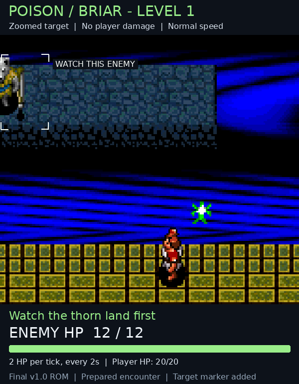
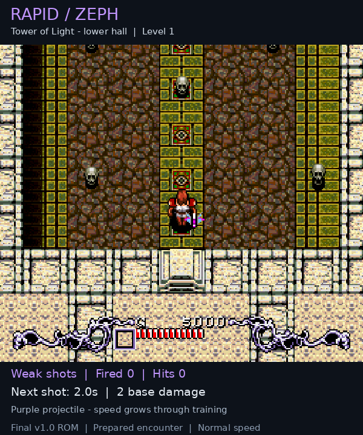
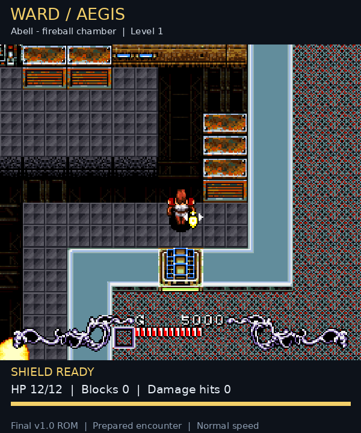
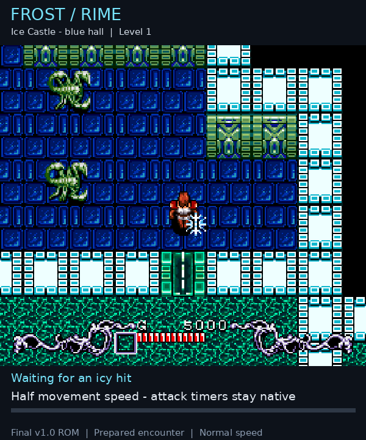
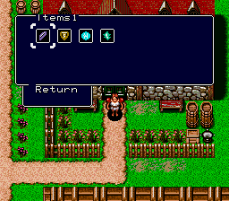
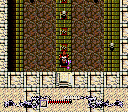
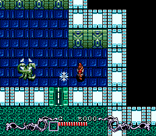
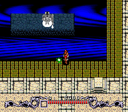

# Brain Lord: Vanilla Plus Fairies v1.0

The original **Brain Lord (USA)** adventure with four additional fairy roles:
**Rapid, Ward, Frost and Poison**. All **13 original individual fairies** keep
their original stats, prices and sources, bringing the roster to **17**.

**[Download v1.0 — BPS patch + readme](https://github.com/RetchERez/brain-lord-vanilla-plus-fairies/releases/download/v1.0/brain_lord_vanilla_plus_fairies_v10.zip)** · [Release page](https://github.com/RetchERez/brain-lord-vanilla-plus-fairies/releases/tag/v1.0) · [Player readme](readme.txt)

The archive is named **brain_lord_vanilla_plus_fairies_v10.zip** — `v10` means version 1.0.

## What changes

- Four new fairies with their own equipped sprites, projectiles and inventory Jade icons
- Four optional dungeon treasure rewards now contain the new Jades
- Each collected blue sphere awards 50 EXP to each equipped eligible fairy, whichever one collects it
- The naming prompt identifies the Jade whose fairy you are naming
- Poison ticks now use the game's native damage flash or blink and enemy hit sound

The original Crimson-only opening and Life's Silver Plaque exchange are preserved.
Original Jade merchants, prices, story gates, enemy placement, sphere drops and
training thresholds remain native. There is no added shopkeeper. The original
two-fairy limit remains, and the ROM is not expanded.

The original second Lightning, Anger, Water and Crimson fairies remain separate
individuals with their original names, levels and powers.

## The four additions

| Jade | Default name | Role | Discovery |
| --- | --- | --- | --- |
| Rapid | Zeph | Small purple, weak aimed shots that become faster through training | Upper Tower of Light |
| Ward | Aegis | Blocks one eligible enemy contact hit, then recharges | Abell side chamber |
| Poison | Briar | One-target damage over time, with native hit feedback | Late Abell |
| Frost | Rime | Icy shots and a cyan aura marking one slowed ordinary enemy | Early Ice Castle |

Ward starts uncharged and recharges in about 10 seconds at level 1, improving
to about 5 seconds at level 19. Frost slows movement for 5 seconds at level 1,
up to an 8-second cap; bosses and boss parts are not slowed.
Poison has no impact damage, stacking, added stun or knockback. A fresh
application can deliver three ticks, two seconds apart; tick damage starts at
2 HP and caps at 7 HP. Bosses and boss parts are immune.

See [all 17 locations](docs/JADE_LOCATIONS.md) and the [full player readme](readme.txt)
for acquisition details, training, safeguards, saves and focused testing.

## Install

- Download and extract the release ZIP
- Select a clean, headerless Brain Lord USA ROM in a BPS-compatible patcher
- Apply the BPS patch once to the clean ROM and save the result under a separate name
- Launch the patched game and start a new game to make all four treasures available
- Keep earlier Jade Overhaul saves and emulator save states separate

Required original ROM:

| Check | Value |
| --- | --- |
| Size | 1,572,864 bytes |
| CRC32 | `AC443D87` |
| SHA-256 | `f4666355e7fea434843dc6d5119673bd6c23e69b884aac0b382ff036997e52b5` |

This is a patch distribution. Supply your own original game; no ROM is included.

## Gameplay GIFs

Prepared level-1 encounters recorded from the final release ROM at normal speed.
The GIFs are 600 pixels wide, with proportional height. Captions and readouts are
video annotations; enemy hit flashes and fairy effects are produced by the ROM.

### Poison — damage ticks and native flashes

Enemy HP drops **12 → 10 → 8 → 6** at two-second intervals. Player HP stays at
20/20 throughout this capture.

### Rapid — small purple shots

### Ward — ready shield, a block, then damage during recharge

This demonstration starts with a prepared charged shield. Ordinary summoning
and room changes start a fresh recharge.

### Frost — icy shots and movement slow

## Native-resolution screenshots

Unscaled **256×224** frames, without captions or overlays. These are prepared
gameplay and inventory showcases. [View all nine screenshots](docs/SCREENSHOTS.md).
[Download the original PNG screenshot pack](https://github.com/RetchERez/brain-lord-vanilla-plus-fairies/releases/download/v1.0/brain_lord_vanilla_plus_fairies_v10_screenshots.zip).

## Checks and support

The release passed **26 native verification groups**, **66 unit tests** and
**9 mathematical regression tests**. All **136 pairs** were compared
mathematically, and all **272 slot orders** were exercised in native combat,
recall and room reload checks. Both native save slots and fresh battery-save
Continue were tested. No full campaign playthrough was performed.

[Verification details](docs/VERIFICATION.md) · [Changelog](CHANGELOG.md) ·
[Report a bug](https://github.com/RetchERez/brain-lord-vanilla-plus-fairies/issues/new/choose) · [Forum-ready BBCode](forum-posts/README.md)

This public repository contains the verified player release, finished media and
support documentation. The release ZIP contains only the BPS patch and readme.

Maintainers can verify the exact patch, ZIP and image dimensions with
`python3 .github/scripts/verify_release.py`. An optional GitHub Actions workflow
example is included under `.github` for accounts with workflow publishing access.

Project by [RetchERez](https://github.com/RetchERez).
